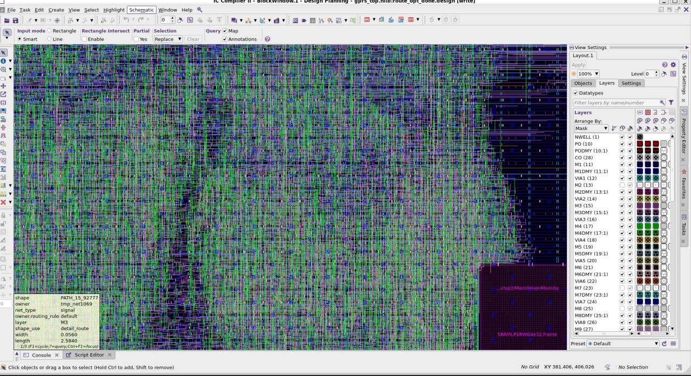

# Narendaran S G — ASIC Physical Design & RTL Verification Portfolio

**Live site:** https://narendaransg.github.io/ · **Resume:** [web](https://narendaransg.github.io/resume.html) · [PDF](https://narendaransg.github.io/Narendaran_S_G_Resume.pdf)

Final-year ECE student at Easwari Engineering College, Chennai, working on RTL-to-GDSII physical design and RTL verification. The site documents my block-level work stage by stage, with real QoR numbers and layout screenshots:

- **gprs_top** (Synopsys ICC2): 33,286 cells, 16 hard SRAM macros, 2,856-sink clock tree at 0.14 ns skew, routed clean with `route_eco`
- **8-bit async FIFO** (Synopsys ICC2): separate `wclk`/`rclk` clock trees, 0 DRC, +0.16 ns setup WNS
- **Cadence Innovus** flow: 0.011 ns skew, 0.00% route overflow
- **OpenLane / SKY130** RTL-to-GDSII, **Genus/Modus** DFT, and a ChipThink hackathon bus arbiter you can clock-step in the browser

## Site sections

| Tab | What's there |
|---|---|
| Overview | Intro, key numbers, a working mock EDA terminal, latest updates |
| Physical Design | Stage-by-stage QoR explorer (floorplan → PDN → placement → CTS → route) |
| Interactive Lab | Metal-stack inspector, bus-arbiter RTL simulator, before/after layout slider, STA slack calculator |
| Chronicles | All projects, filterable by area |
| Credentials | Certificates, internship, contact |

Deep links work: `/#qor`, `/#lab`, `/#projects`, `/#credentials`.

## How it's built

Plain HTML/CSS/JS on GitHub Pages, no framework.

| File | Purpose |
|---|---|
| `index.html` | Page structure for all five views |
| `portfolio-data.js` | QoR numbers, stage text, terminal command output |
| `portfolio-engine.js` | View router, background canvas, QoR explorer, simulators, terminal, updates strip |
| `silicon-addons.js`, `chip-borders.js`, `chip-mascot.js` | Command palette, layout slider, STA calculator, frame styles, help bot |
| `portfolio-theme.css` | Dark / light themes |
| `tailwind.css` | Built Tailwind CSS (generated, don't edit) |
| `updates.json` | "Latest Updates" entries |
| `resume.html` | Printable A4 resume; `Narendaran_S_G_Resume.pdf` is generated from it |

## Updating the site

- **Add an update:** put a new entry at the top of `updates.json`. Add `"linkedin": true` to have it shared on LinkedIn automatically (see below).
- **Edit the resume:** change `resume.html`; the PDF is regenerated on push.
- **New Tailwind classes:** just use them; `tailwind.css` is rebuilt on push. To preview locally first: `npx tailwindcss@3 -i tailwind.src.css -o tailwind.css --minify`.

The GitHub Action in `.github/workflows/site.yml` handles the rebuilds and commits the generated files back.

### Optional: auto-share updates on LinkedIn

1. Create an app at <https://www.linkedin.com/developers/apps> and add the **Share on LinkedIn** product (gives the `w_member_social` permission). Also add **Sign In with LinkedIn using OpenID Connect** so you can look up your member ID.
2. Generate a member access token with the `openid profile w_member_social` scopes (the developer portal's OAuth token tool works).
3. Call `GET https://api.linkedin.com/v2/userinfo` with that token; the `sub` value is your ID. Your URN is `urn:li:person:`.
4. In this repo: **Settings → Secrets and variables → Actions**, add `LINKEDIN_ACCESS_TOKEN` and `LINKEDIN_PERSON_URN`.

Each entry is posted once (tracked in `.github/linkedin-posted.json`). LinkedIn tokens expire, so when a post fails with 401, generate a new token and update the secret. LinkedIn doesn't let personal apps edit your profile itself (headline, experience, etc.), only create posts.

## Contact

sgnarendaran@gmail.com · [LinkedIn](https://www.linkedin.com/in/narendaran-s-g-886273291) · [EDA Playground](https://www.edaplayground.com/x/JiD3)
